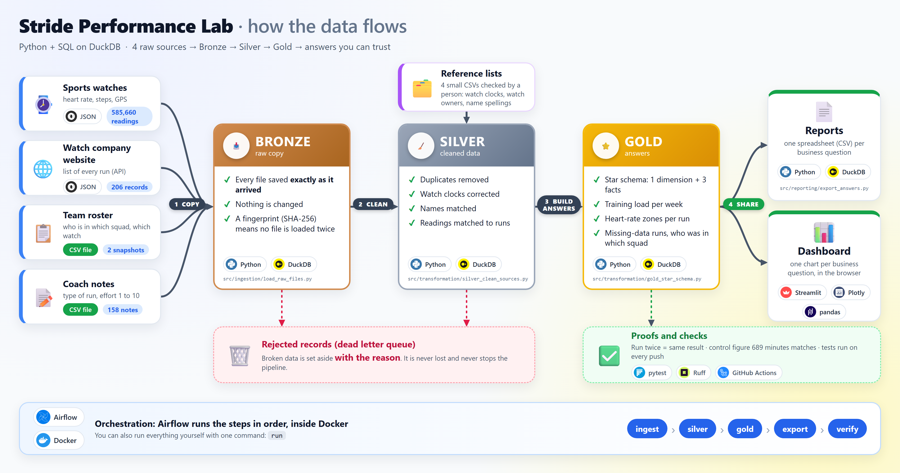
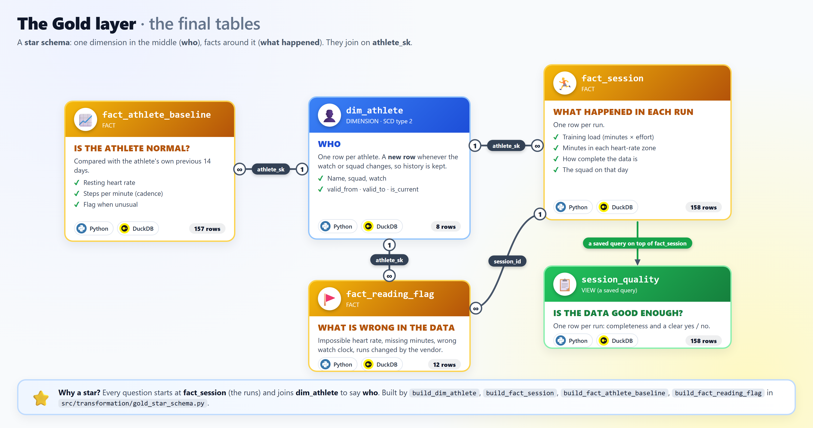

# Stride Performance Lab: training data pipeline

Six runners wear sports watches. Their training data sits in four places: the **watches**, the **watch company's website**,
the **team list** spreadsheet and the **coach's notes**. Each has mistakes in it, and nobody had joined them. This project
loads all four, fixes the mistakes, and answers the coach's questions (training load per week, heart-rate zones per run,
which runs are missing data, who was in which squad) as tables, CSV files and charts you can trust.

It is written in **Python**; every calculation is **SQL** run by **DuckDB** (a small database that lives in one file).



**Quick start (Windows).** The original assessment files are already in `data\raw`. Type these in a terminal, one line at a time:

```powershell
python -m venv .venv
.venv\Scripts\Activate.ps1
pip install -r requirements.txt
run
```

After about 20 seconds you see a progress log and, at the end, the control figures (4 / 5 / 4 / 4 / 4 / 2 sessions and
689 minutes). Full instructions are in [How to run](#how-to-run).

## Where to start reading the code

Follow the data, in this order. All code is in the `src` folder. Every file starts with a short header that says what goes in and what comes out.


| # | File                                                                                                                                  | What you will see                                                                                   |
| - | ------------------------------------------------------------------------------------------------------------------------------------- | --------------------------------------------------------------------------------------------------- |
| 1 | [src/main.py](src/main.py)                                                                                                            | **Start here.** The list of commands. `cmd_run` shows the 4 steps in order                          |
| 2 | [src/ingestion/load_raw_files.py](src/ingestion/load_raw_files.py)                                                                    | Step 1: copies every raw file into`bronze.raw_*` tables, unchanged                                  |
| 3 | [src/transformation/silver_clean_sources.py](src/transformation/silver_clean_sources.py)                                              | Step 2: one`build_<table>` function per cleaned table (`stg_*`, `ref_*`)                            |
| 4 | [src/transformation/gold_star_schema.py](src/transformation/gold_star_schema.py)                                                      | Step 3: the star schema:`dim_athlete`, `fact_session`, `fact_athlete_baseline`, `fact_reading_flag` |
| 5 | [src/reporting/business_questions.sql](src/reporting/business_questions.sql) and [export_answers.py](src/reporting/export_answers.py) | Step 4: the SQL for each answer, and the code that saves it as a CSV                                |
| 6 | [src/validation/verify_pipeline.py](src/validation/verify_pipeline.py)                                                                | The proofs: run twice, deliveries one by one, one day alone, 689                                    |

Each `build_` function has a header like this, so you can see what it reads and writes without opening the SQL:

```python
def build_dim_athlete(con):
    """GOLD | DIMENSION | SCD TYPE 2
    Reads : silver.stg_roster, silver.ref_device_assignment
    Writes: gold.dim_athlete (1 row per athlete per version; a new version when the watch or squad changes)"""
```

## Folders

```
Project_Pipeline
├── src                              ALL the pipeline code
│   ├── main.py                      START HERE: every command (run, test, verify ...)
│   ├── common
│   │   ├── settings.py              paths, the DuckDB file, season dates, thresholds (the only place for settings)
│   │   ├── errors.py                clear error messages and the checks that raise them
│   │   └── sql_helpers.py           saves a SELECT as a table and prints its row count
│   ├── ingestion
│   │   └── load_raw_files.py        raw files -> bronze tables (copy as is)
│   ├── transformation
│   │   ├── silver_clean_sources.py  bronze -> silver (clean, remove copies, fix clocks, match notes to runs)
│   │   └── gold_star_schema.py      silver -> gold (dimension + facts)
│   ├── reporting
│   │   ├── business_questions.sql   all the business queries in one file
│   │   └── export_answers.py        runs the queries -> output\*.csv, prints the control figures
│   └── validation
│       ├── profile_raw_data.py      audits the raw files (112 checks)
│       └── verify_pipeline.py       the proofs: rerun identical, drops 1->2->3, one day, 689
├── orchestration\airflow            Dockerfile, docker-compose.yml, dags\stride_pipeline_dag.py
├── dashboard\app.py                 Streamlit charts
├── tests                            test_pipeline.py + fixtures\raw (5 tiny made-up files)
├── dlq_demo                         try the dead letter queue on broken files (see its README)
├── data
│   ├── raw                          the original assessment files (never changed)
│   ├── reference                    4 lists checked by a person (aliases, clock offsets, device dates, one pairing)
│   └── warehouse                    stride.duckdb (made by "run"; not on GitHub)
├── output                           one CSV per business question (made by "run"; not on GitHub)
├── docs                             architecture.md, data_issues.md, data_contract.md, session_quality.csv, images
├── Makefile                         optional shortcuts: make run, make verify ...
├── requirements.txt                 the Python libraries, with exact versions
├── pyproject.toml                   creates the one-word commands; settings for Ruff and pytest
├── .gitignore · .gitattributes      what git ignores (database, output, caches) · same line endings on every computer
└── .github\workflows\ci.yml         GitHub runs the tests on every push
```

## Naming convention


| Rule                                                                           | Example                                                                                                                                      |
| ------------------------------------------------------------------------------ | -------------------------------------------------------------------------------------------------------------------------------------------- |
| The schema and the prefix tell you the layer                                   | `bronze.raw_*` raw copy · `silver.stg_*` staging (cleaned) · `silver.ref_*` reference list · `gold.dim_*` dimension · `gold.fact_*` fact |
| `snake_case`, with the unit in the name                                        | `duration_min`, `hr_bpm`, `cadence_spm`, `completeness_pct`, `ts_utc`                                                                        |
| Yes/no columns start with`is_` or `was_`                                       | `is_complete`, `is_hr_glitch`, `was_changed_by_vendor`                                                                                       |
| `*_id` is a natural key (from the source), `*_sk` a surrogate key (made by us) | `athlete_id` = A01 · `athlete_sk` = 1                                                                                                       |
| One function per table, named`build_<table>`                                   | `build_fact_session` builds `gold.fact_session`                                                                                              |

Code style is checked by Ruff (`make format`, or type `format`).

## How to run

### What you need

- A **Windows** computer.
- **Python 3.11 or newer**, from [python.org](https://www.python.org/downloads/). During the install tick **"Add python.exe to PATH"**.
- **VS Code** (or any terminal). In VS Code open this folder, then **Terminal → New Terminal**.
- **Only for Airflow:** **Docker Desktop**, from [docker.com](https://www.docker.com/products/docker-desktop/).

### First time only: set up

Type these lines in the terminal, one at a time.

**1. Create a private Python space for this project** (a folder called `.venv`):

```powershell
python -m venv .venv
```

**2. Switch it on.** Afterwards every line in the terminal starts with `(.venv)`:

```powershell
.venv\Scripts\Activate.ps1
```

If you see *"running scripts is disabled on this system"*, type this once and repeat step 2:

```powershell
Set-ExecutionPolicy -Scope Process -ExecutionPolicy Bypass
```

**3. Install what the project needs.** This also creates the short commands (`run`, `verify`, `test` …):

```powershell
pip install -r requirements.txt
```

**4. The data is already there.** The original assessment files come with the repository, in `data\raw`
(`device_sync`, `vendor_api`, `roster`, `coach_app` and `firmware`). The project only reads these files and never changes them.
To use a new delivery, put its files in the same folders.

### Every time: run it

```powershell
.venv\Scripts\Activate.ps1
run
```

You see a progress log, then your result:

```
[1/4] Ingestion
      bronze.raw_device_sync ..............   585,660 rows
      ...
[2/4] Silver
      silver.stg_device_reading ...........   583,320 rows
      ...
[3/4] Gold
      gold.fact_session ...................       158 rows
      ...
[4/4] Export
      output/ .............................         6 files
Done in 15.7s

  Athlete       Sessions
  Ali Raza             4
  Sara Khan            5
  Hamza Tariq          4
  Zainab Mirza         4
  Bilal Ahmed          4
  Mehak Noor           2
  Total logged minutes, Endurance squad: 689
```

The table is the number of runs per athlete in the week of 10–16 August 2026, and the total minutes of the Endurance squad
that week. The other answers are saved as CSV files in the `output` folder.

### See the charts: `dashboard`

```powershell
dashboard
```

Your web browser opens by itself with the charts: the control figures, weekly training load, heart-rate zones, the sessions
below 95% complete, the roster on 14 August and the list of discrepancies. If it does not open, go to
**http://localhost:8501**. Type **Ctrl + C** in the terminal to close it. Type `run` first if you see
"Warehouse not built yet".

### See the pipeline in Airflow: `airflow-up`, `airflow-run`, `airflow-down`

Needs Docker Desktop (see [Watching the pipeline in Airflow](#watching-the-pipeline-in-airflow)). Three commands:

```powershell
airflow-up      # starts Airflow and prints the user name and password
airflow-run     # runs the pipeline in Airflow and opens the page where you watch the steps turn green
airflow-down    # stops Airflow
```

### All commands

Each one-word command also works as `make <command>` (if you installed `make`) and as `python src\main.py <command>`.
`make` is not part of Windows; the one-word commands do the same thing. To install it: `winget install ezwinports.make`.


| Type this                                       | What happens                                                                                                                                                   | What you see                                                       |
| ----------------------------------------------- | -------------------------------------------------------------------------------------------------------------------------------------------------------------- | ------------------------------------------------------------------ |
| `run`                                           | Everything: copy the raw files, clean them, build the star schema, save the CSV files.`run --drop 1` loads only watch delivery 1 (then `--drop 2`, `--drop 3`) | The progress log and your result                                   |
| `ingest` · `silver` · `gold` · `export`      | Only one step of`run`                                                                                                                                          | That step's tables and row counts                                  |
| `reprocess --day 2026-08-14`                    | Redoes one day only; every other day stays exactly as it was                                                                                                   | The tables of that day and their rows rebuilt                      |
| `audit`                                         | Repeats the first inspection of the raw files (112 checks)                                                                                                     | A summary; the report is saved as`output\raw_data_audit_report.md` |
| `verify`                                        | Proves the pipeline is safe (see[Reconciliation](#reconciliation)). Takes about 1 minute                                                                       | 4 PASS lines                                                       |
| `test`                                          | Runs the automatic tests                                                                                                                                       | `53 passed`                                                        |
| `format`                                        | Tidies the code (Ruff)                                                                                                                                         | `All checks passed!`                                               |
| `dashboard`                                     | Opens the charts in your browser;**Ctrl + C** closes it                                                                                                        | A page at http://localhost:8501                                    |
| `clean`                                         | Deletes the database and`output`, to start from zero. Never touches `data\raw` or `data\reference`                                                             | `Removed ...`                                                      |
| `airflow-up` · `airflow-run` · `airflow-down` | Start Airflow, run the pipeline in it, stop it (see below)                                                                                                     | Web address, user, password                                        |

### When something is missing: one clear message

A command that cannot work stops with one line starting with `ERROR:` and does not show a long stack of technical text.


| You see                                                                                                           | What to do                                                    |
| ----------------------------------------------------------------------------------------------------------------- | ------------------------------------------------------------- |
| `ERROR: Warehouse not built yet. Run 'make run' first.`                                                           | Type`run` (it works the same as `make run`)                   |
| `ERROR: No raw data in data/raw. See README > How to run.`                                                        | Unzip the data into`data\raw` (step 4)                        |
| `ERROR: DROP must be 1 to 3 ...` · `ERROR: DAY must look like YYYY-MM-DD ...` · `... is outside the season ...` | Fix the number or date you typed                              |
| `ERROR: The warehouse is open in another program. Close the dashboard ...`                                        | Close the dashboard, DuckDB UI or Airflow run, then try again |
| `ERROR: Docker is not running. ...`                                                                               | Open Docker Desktop and wait for "Engine running"             |
| `ERROR: Silver failed. silver.stg_session could not be built: ...`                                                | The message names the step and the table that failed          |

### Bad records: the dead letter queue

If a file or a record is broken, the pipeline does **not** stop and does **not** throw it away. It puts it in a "dead letter
queue", the table `bronze.dlq_rejected_record`, with the time, the step, the file, the reason and the original record.
A broken record is one that cannot be read (bad date, not a number), has an unknown layout, names an athlete we don't know,
or matches no run. The last line of every run shows the count, and `output\dlq_rejected_records.csv` lists them:

```
Rejected records (DLQ): 0
```

The real data has 0 rejected records. To see it work, open the folder [dlq_demo](dlq_demo/README.md): it has broken files
and a script that runs the pipeline on them and says PASS or FAIL. The tests do the same with made-up files. More in
[docs/architecture.md](docs/architecture.md#7-the-dead-letter-queue-dlq).

### Watching the pipeline in Airflow

**Airflow** runs a pipeline step by step and shows each step on a web page: waiting, running, done (green) or failed (red).
It runs inside **Docker** (a program that runs software in a sealed box), so you don't install Airflow yourself.

1. Install **Docker Desktop**, open it, and wait until it says *Engine running*. On Windows this needs **WSL 2** and
   virtualization switched on: open PowerShell **as Administrator**, type `wsl --install`, restart the computer, then install
   Docker Desktop and accept its WSL 2 option. If Docker says virtualization is off, turn it on in the BIOS (Intel VT-x).
2. In the terminal (private Python space switched on) type `airflow-up`. The first time takes a few minutes. When it is ready
   you see `Airflow is ready: http://localhost:8080   user: admin   password: ...`.
3. Open **http://localhost:8080** and log in with that user name and password. You see one pipeline, **stride_pipeline**.
4. In the terminal type `airflow-run`. Your browser opens on the pipeline page.
5. In the browser click **stride_pipeline**, then **Graph**. Five boxes turn green one by one:
   **ingestion → silver → gold → export → verify**. Click a box, then **Logs**, to read what the step printed. The **export**
   log shows your result.
6. When you are finished type `airflow-down`.

Airflow and `run` use the same database file, so don't type `run` while Airflow is running the pipeline.

If Airflow says *"still starting"* for more than a few minutes (this can happen after Docker was restarted while Airflow was running), type `airflow-down`, delete the folder `orchestration\airflow\airflow_home` (it only holds Airflow's own run history), and type `airflow-up` again.

### What happens inside, step by step

```
data\raw        the files as they arrived (never changed)
   |
   |  step 1  Ingestion   copy every file into the database exactly as it is        -> "bronze" tables
   |  step 2  Silver      fix the mistakes: watch clocks, copies, two file formats,
   |                      name spellings; match each reading and each note to its run -> "silver" tables
   |  step 3  Gold        build the star schema: who (dim_athlete) and what happened (facts) -> "gold" tables
   |  step 4  Export      run reporting\business_questions.sql, save each answer        -> output\*.csv
   v
output\  and  the dashboard
```

"Bronze, silver, gold" are the usual names for "raw copy, cleaned, answers". A few facts that the data itself does not say
(for example the date a watch changed hands) were decided by a person and written in small lists in `data\reference`.

### Where to find the code for …


| How …                                                     | Look in                                                                                                      |
| ---------------------------------------------------------- | ------------------------------------------------------------------------------------------------------------ |
| a raw file is copied into the database                     | `src/ingestion/load_raw_files.py` → `load_device_sync_file`                                                 |
| the old and new watch file formats are combined            | `src/transformation/silver_clean_sources.py` → `build_stg_device_reading` (`sample` step)                   |
| watches that record twice per second are counted correctly | `build_stg_device_reading` (`sample_interval_s`)                                                             |
| copied readings are removed                                | `build_stg_device_reading` (`copy_no`)                                                                       |
| each watch's clock is corrected (including Zainab's)       | `data/reference/device_clock_offset.csv` and `build_stg_device_reading` (`utc` step)                         |
| repeated runs on the website are removed, the retry wins   | `build_stg_session` (`version`, `latest` steps)                                                              |
| the team changes on 11 August are applied                  | `data/reference/device_assignment.csv`, `build_stg_session` and `gold_star_schema.py` → `build_dim_athlete` |
| the coach's name spellings and notes are matched           | `data/reference/athlete_alias.csv` and `build_stg_session` (`label`, `matched` steps)                        |
| each reading is matched to its run                         | `build_stg_device_reading` (`in_session` step)                                                               |
| the impossible heart rate of 247 is caught                 | `build_stg_device_reading` (`is_hr_glitch`)                                                                  |
| heart-rate zones are decided                               | `build_fact_session` (`reading` step)                                                                        |
| missing data per run (completeness) is measured            | `build_fact_session` (`observed_samples`, `is_complete`)                                                     |
| the list of problems is built                              | `build_fact_reading_flag`                                                                                    |
| weekly training load is calculated                         | `src/reporting/business_questions.sql` → `weekly_training_load`                                             |

---

## Grain and keys

"Grain" means **what one row stands for**. "Key" means **the column(s) that make each row different from every other row**,
like a name tag. Every key is tested automatically: no two rows share it, and it is never empty.

**The final Gold layer, at a glance.** One dimension (who) in the middle and three facts (what happened) around it:



The detailed picture with every column, key and the SCD2 columns is [docs/images/erd.png](docs/images/erd.png).

**The Gold star schema** (full column lists: [docs/architecture.md](docs/architecture.md)):


| Table                              | Type                    | One row stands for                                                              | Key                         | Why this grain                                                                                                                                                                         |
| ---------------------------------- | ----------------------- | ------------------------------------------------------------------------------- | --------------------------- | -------------------------------------------------------------------------------------------------------------------------------------------------------------------------------------- |
| `gold.dim_athlete` (8)             | dimension, SCD type 2   | one**version** of an athlete: a new row whenever the watch or the squad changes | `athlete_sk`                | The roster files have no dates. Keeping each period (`valid_from` inclusive, `valid_to` exclusive) lets every run use the squad of *that day*; this is what makes 689 correct          |
| `gold.fact_session` (158)          | fact                    | one run                                                                         | `session_id`                | The assessment asks for one row per session. One wide table answers load, zones and quality without joins.`squad` is copied onto it on purpose, from the version valid on the run date |
| `gold.fact_athlete_baseline` (157) | fact                    | one athlete on one day with a run                                               | `athlete_sk, baseline_date` | A baseline belongs to an athlete, but you judge it day by day. Sara's two runs on 12 Aug are one row                                                                                   |
| `gold.fact_reading_flag` (12)      | fact                    | one flagged reading, run, watch or firmware group                               | `flag_id`                   | Question 5. 2,340 copied readings in one run are one row, which keeps the list readable                                                                                                |
| `gold.session_quality` (158)       | view over`fact_session` | one run                                                                         | `session_id`                | The table the assessment asks for by name                                                                                                                                              |

**The answer files** in `output\` (each is one query in `src/reporting/business_questions.sql`: the README's questions Q1 to Q5, plus the dead letter queue). The two control figures (4/5/4/4/4/2 and 689) are the queries `print_*` in the same file; they are printed at the end of `run` and are not saved as files. The `session_quality` table is `gold.session_quality` (also copied to `docs\session_quality.csv`), and the baseline is `gold.fact_athlete_baseline`:


| CSV                                                       | Built from                              | One row                                                                                            | Joins |
| --------------------------------------------------------- | --------------------------------------- | -------------------------------------------------------------------------------------------------- | ----- |
| `weekly_training_load` (43)                               | `fact_session` + `dim_athlete`          | one athlete in one Monday–Sunday week (quiet weeks kept as 0; Mehak has 3 weeks: 5 × 8 + 3 = 43) | 1     |
| `session_hr_zones` (158)                                  | `fact_session`                          | one run                                                                                            | 0     |
| `sessions_below_threshold` (2)                           | `session_quality` view                  | one run                                                                                            | 0     |
| `roster_snapshot_2026_08_14` (6)                          | `dim_athlete`                           | one athlete on 14 August                                                                           | 0     |
| `reading_discrepancies` (12)                              | `fact_reading_flag` + `dim_athlete`     | one problem found                                                                                  | 1     |
| `dlq_rejected_records` (0)                                | `bronze.dlq_rejected_record`            | one rejected file or record, with the reason and the original payload                              | —    |

The cleaned tables these come from (`silver.stg_*`, `silver.ref_*`) are described in
[docs/architecture.md](docs/architecture.md#5-every-table).

---

## What I found

24 problems in the data. For each: **what we saw → why it happened → what we did, and why**. The full list with counts and
examples is in [docs/data_issues.md](docs/data_issues.md).

The detailed flow map below shows where each problem enters (⚠️) and where it is fixed. The codes (like TZ-02) match the tables below. The same map as a table is in [docs/architecture.md](docs/architecture.md#3-flow-map-where-each-problem-lives).


**Watch readings (585,660)**


| Problem                                              | What we saw                                                                                | Why                                                                            | What we did                                                                                                                                 |
| ---------------------------------------------------- | ------------------------------------------------------------------------------------------ | ------------------------------------------------------------------------------ | ------------------------------------------------------------------------------------------------------------------------------------------- |
| Watch times have no time zone (TZ-01)                | A time like`06:20:00` with no hint of which clock it is                                    | Each watch writes its own local clock                                          | Converted every watch to world time (UTC) using a checked list of each watch's clock                                                        |
| Zainab's watch is set to the wrong time zone (TZ-02) | Zainab's readings were 2 hours away from all 30 of Zainab's runs, so Zainab would have had zero minutes | The watch is set to UTC+3 instead of Pakistan time (UTC+5)                     | Corrected the watch by 3 hours. The GPS shows Zainab was in Islamabad and started runs with the teammates, so it is a wrong setting, not travel |
| Two readings per second (TIME-01)                    | Readings at`06:30:00` and `06:30:00.5`                                                     | A watch software update (2.4.0) records twice per second                       | Each of these readings counts as half a second. Counting them as whole seconds would turn 689 minutes into 921                              |
| The watch release notes are wrong (XS-04)            | The notes say the update needs app 5.2.0, but 4 files came through the old app             | The notes are wrong                                                            | Decided "half a second" from the times themselves, never from version numbers                                                               |
| GPS distances are wrong (TIME-02, VAL-02)            | GPS distance is 66% too long on updated watches and 16% too short on others                | The update moves the GPS point every half second; normal GPS error on the rest | Used the watch company's distance only                                                                                                      |
| Two file formats (STR-01/02/03)                      | Half the heart rates seemed to be missing; steps per minute stored as text                 | An app update renamed the fields and changed their format                      | Read both names into one column and turned text into numbers                                                                                |
| One run uploaded twice (DUP-01)                      | Ali's 39-minute run on 29 July would count as 78 minutes                                   | The same readings arrived in two files                                         | Kept one copy of each reading                                                                                                               |
| Impossible heart rate 247 (VAL-01)                   | `137, 247, 135` on 13 July, above Ali's maximum of 190                                     | A sensor glitch                                                                | Marked it as faulty and left it out. We did not invent a replacement value                                                                  |
| Readings don't say which run they belong to (XS-01)  | No run number in a reading                                                                 | The watch doesn't know about the website's runs                                | Matched each reading to the run on the same watch at the same time                                                                          |
| A 4-minute hole in one run (XS-03)                   | Sara, 5 August: no readings for 240 seconds                                                | The watch lost contact                                                         | Left the hole empty ("a gap means we weren't listening") and marked the run as 90.2% complete                                               |
| Late uploads (TIME-03)                               | 4 runs of 15 August only have readings in the third delivery                               | Uploads can arrive days later                                                  | Each run of the pipeline uses everything received so far. After delivery 3 the answers are complete (proved by`verify`)                     |

**Runs on the watch company's website (206 rows → 158 real runs)**


| Problem                                      | What we saw                                                                                    | Why                                  | What we did                                                                             |
| -------------------------------------------- | ---------------------------------------------------------------------------------------------- | ------------------------------------ | --------------------------------------------------------------------------------------- |
| Runs listed twice (DUP-02)                   | 5 runs appear on two pages                                                                     | The website's pages overlap          | Kept each run once                                                                      |
| A run changed between two downloads (DUP-03) | Bilal's run on 21 August: 34 minutes in one download, 40 in the next. The watch has 34 minutes | The company edited the run           | Kept both versions and used the newest, so the run shows as 85% complete and is flagged |
| More runs per page than promised (STR-04)    | A page says 40 runs but has 43                                                                 | Website fault                        | Read every run on every page                                                            |
| Every run says "complete" (VAL-03)           | All 206 say complete, but 2 are not                                                            | The website's label can't be trusted | Ignored it and measured completeness ourselves                                          |

**Team list (11 rows) and coach notes (158 rows)**


| Problem                                    | What we saw                                                                               | Why                                    | What we did                                                                                                                               |
| ------------------------------------------ | ----------------------------------------------------------------------------------------- | -------------------------------------- | ----------------------------------------------------------------------------------------------------------------------------------------- |
| Team changes have no dates (ID-01)         | The July and September lists differ: Hamza changed watch, Mehak joined, Bilal moved squad | The lists are snapshots, not a history | Found the date from the data:**11 August**. Each run uses the team as it was on the day of that run. Without this, 689 becomes 644 or 696 |
| 29 spellings of 6 names (ID-02)            | `ALI RAZA`, `Ali  Raza`, `Ali R.` …                                                      | Names typed by hand                    | A checked list that maps every spelling to the right athlete                                                                              |
| Coach notes don't say which run (XS-02)    | Only a name and a date                                                                    | Separate app                           | Matched each note to the athlete's run on that date: 158 notes ↔ 158 runs                                                                |
| Two runs and two notes on one day (DUP-04) | Sara ran twice on 12 August                                                               | Two runs that day                      | The calm run got the "Easy" note and the hard run the "Tempo" note, marked as a guess                                                     |
| Coach note time has no time zone (TZ-03)   | The time the note was typed has no clock                                                  | Coach app                              | Not used                                                                                                                                  |

**Question 5, using each athlete's own normal values (`fact_athlete_baseline`):** each day's resting heart rate and steps per minute are compared with the same athlete's previous 14 days (a baseline needs at least 3 earlier days with a run). The biggest change all season is 3.6 beats per minute and 6 steps per minute, under our limits (5 and 8). So **no athlete shows an unusual change**: the problems are in the data, not in the runners.

---

## Reconciliation

The assessment gives expected figures for the week **10–16 August 2026**. Our results match every one of them exactly.


|                                    | Expected | Our result | Runs                                                        |
| ---------------------------------- | -------- | ---------- | ----------------------------------------------------------- |
| Ali Raza, runs                     | 4        | 4 ✅       | 10, 12, 14, 15 Aug                                          |
| Sara Khan, runs                    | 5        | 5 ✅       | 10, 12 (twice), 14, 15 Aug                                  |
| Hamza Tariq, runs                  | 4        | 4 ✅       | 10 Aug on the old watch, then 12, 14, 15 Aug on the new one |
| Zainab Mirza, runs                 | 4        | 4 ✅       | 10, 12, 14, 15 Aug (after correcting the watch clock)       |
| Bilal Ahmed, runs                  | 4        | 4 ✅       | 10, 12, 14, 15 Aug                                          |
| Mehak Noor, runs                   | 2        | 2 ✅       | 14, 15 Aug (joined on 11 Aug)                           |
| **Endurance squad, total minutes** | **689**  | **689** ✅ | Ali 232 + Sara 284 + Mehak 128 + Bilal 45                   |

It only matches because each run counts for the squad the athlete was in **on that day**. Bilal ran 45 minutes for
Endurance on 10 August, then moved to the Speed squad. Other ways of counting give the wrong total:


| If you …                                          | Endurance minutes                                         |
| -------------------------------------------------- | --------------------------------------------------------- |
| use the September team list for the whole week     | 644 (misses Bilal's run on 10 Aug)                        |
| use the July team list for the whole week          | 696 (counts Bilal's Speed runs and misses Mehak)          |
| count every watch reading as one second            | 921 (updated watches record twice per second)             |
| add up the minutes from the watch readings instead | 689 (the same: every Endurance run that week is complete) |

**Safe to run again, and safe when data arrives in parts.** The `verify` command proves it:

```
[PASS] Control figures: sessions [4, 5, 4, 4, 4, 2], Endurance minutes 689
[PASS] Rerun identical: 11 tables and 6 CSVs identical after a second full run
[PASS] Drop by drop = all at once: drop 1: 52 complete runs, 0 differ from final; drop 2: 110 complete runs,
       0 differ from final; drop 3: 156 complete runs, 0 differ from final; after drop 3, 11 of 11 tables identical
[PASS] One-day reprocess: 2026-08-14: re-copied 6 watch files; rebuilt that day in 3 of 3 tables;
       93 of 93 other table-days untouched (built_at unchanged); every value unchanged
```

"Identical" means a **fingerprint** (row count plus the sum of a hash of every row) of each table is equal, and the CSV files
are equal byte for byte. After deliveries 1 and 2 some runs have no readings yet (they arrive later), but every run that is
already complete has its final numbers.

---

## Definitions


| Word                 | Meaning here                                                                                                                                                                                                                                                                                                                                   |
| -------------------- | ---------------------------------------------------------------------------------------------------------------------------------------------------------------------------------------------------------------------------------------------------------------------------------------------------------------------------------------------- |
| **Session**          | One run, as listed on the watch company's website, using its newest version. 158 runs. A watch reading belongs to a run when it comes from that run's watch, between its start and end time                                                                                                                                                    |
| **Week**             | Monday to Sunday, in Pakistan time (UTC+5). The season (6 July – 30 August 2026) is 8 weeks                                                                                                                                                                                                                                                   |
| **Completeness**     | The share of a run's seconds that have at least one watch reading. A watch that records twice per second still counts each second once. Missing seconds are never filled in                                                                                                                                                                    |
| **Threshold**        | **95%**. A run below 95% complete is flagged. 156 runs are 100% complete; the two flagged ones are Sara's run with a 4-minute hole (90.2%) and Bilal's run that the website later made 6 minutes longer (85.0%). 95% still allows a short loss of signal (2 minutes in a 40-minute run). Changing it is one number in `src/common/settings.py` |
| **Load**             | **Minutes × how hard the coach rated the run (1–10)**, added up per week. This is a standard coaching measure called session-RPE. Next to it we also show **heart-rate zone points**: minutes in each zone × the zone number (zone 1 = 1 point per minute … zone 5 = 5)                                                                    |
| **Logged minutes**   | The run's length according to the watch company's website                                                                                                                                                                                                                                                                                      |
| **Heart-rate zones** | Based on each athlete's maximum heart rate: zone 1 below 60%, zone 2 60–70%, zone 3 70–80%, zone 4 80–90%, zone 5 90% and above                                                                                                                                                                                                             |
| **Baseline**         | An athlete's normal resting heart rate (the lowest full minute of a run) and steps per minute: the middle value of the same athlete's runs in the previous 14 days. It needs at least 3 earlier days with a run. A day is*unusual* when resting heart rate is more than 5 beats per minute away, or steps per minute more than 8 away          |

---

## Tests

Type `test` to run the automatic tests ([tests/test_pipeline.py](tests/test_pipeline.py), written in Python + SQL). The
tests first build the whole pipeline on 5 tiny made-up files in `tests\fixtures\raw`, then check each rule with a SQL query.
`test` needs the real warehouse first (type `run`); GitHub runs the same tests with `pytest` directly.

- **36 tests run everywhere**, including on GitHub, where the database is not built: the rules below, the proofs on the
  made-up files, every error message (no warehouse, no raw data, bad DROP or DAY, a locked database, Docker, a failed step),
  bad records landing in the dead letter queue, and the Airflow DAG (five tasks in order, each running the same function as the command line; tested without Docker).
- **17 tests check the real warehouse** and skip themselves when it is not there: no duplicate or empty keys in 13 tables, one
  row per run, every reading connected to a run, sensible values, and the expected figures (4/5/4/4/4/2 and 689).

The two tests I chose to write first, and what each protects against:

1. **`test_2hz_watch_is_not_counted_twice`** gives the pipeline a made-up run of 2 seconds with 3 readings half a second
   apart, and checks the run counts as 2 seconds of data (100% complete), not 3 seconds (150%).
   **It protects against** the most expensive mistake in this data: counting readings as seconds. That would turn 689
   minutes into 921, put runs above 100% complete and double the heart-rate zone minutes.
2. **`test_watch_clock_offset_is_corrected_per_device`** gives the pipeline two made-up watches set to different time zones
   and checks both land at the right time inside their run.
   **It protects against** silently losing a whole athlete: with one clock setting for everyone, Zainab's 30 runs would have
   no readings at all, and nothing would show an error.

---

## AI usage

I used an AI coding assistant (Claude, in VS Code) as a pair programmer to: profile the raw data, draft the SQL for Silver
and Gold, write the tests, the proofs, the dashboard and the Airflow files, and write and explain these documents. A fuzzy
text-matching library (RapidFuzz) drafted the list of name spellings once; a person reviewed it, and the pipeline never
matches names fuzzily. Every number in this README comes from a query I ran, and each decision the data could not settle is
written as a team question in [docs/data_issues.md](docs/data_issues.md#4-questions-the-team-must-answer).

**What it got wrong, and how I noticed:**


| What the AI said or did                                                          | What was wrong                                                                                                                          | How it was noticed                                                                                                                                                               |
| -------------------------------------------------------------------------------- | --------------------------------------------------------------------------------------------------------------------------------------- | -------------------------------------------------------------------------------------------------------------------------------------------------------------------------------- |
| An early analysis said app 5.2.0 heart rate and GPS were**missing**              | They were only**renamed** (`hr` → `heart_rate`, `lat` → `gps.lat`)                                                                    | Counting the field names in every reading: 0 blanks                                                                                                                              |
| Its first clock test found one of Sara's runs at "UTC−6.25", a second time zone | A fake match: Sara ran twice on 12 Aug, and shifting the evening run by 6¼ hours landed inside the morning run                          | −6.25 h is not a real time zone, and only one run had it. The test now checks that readings really*start* at the run's start                                                    |
| Planned to simply "fix" Zainab's UTC+3 clock                                     | It never asked whether Zainab could really have been abroad                                                                                | I asked; we checked GPS and start times first, and the decision is written down                                                                                                  |
| Its "heart-rate jumps" check reported about 150 jumps                            | It compared the end of one run with the start of the next, days later                                                                   | All the "jumps" were at run start times; only the 247 was real                                                                                                                   |
| Its first spike rule also flagged the normal reading next to 247                 | It compared with the average of both neighbours                                                                                         | Changed to "far from**each** neighbour"                                                                                                                                          |
| It accepted the release note "GPS unchanged on 2.4.0"                            | GPS moves twice as far per second on 2.4.0                                                                                              | GPS distance against vendor distance, split by firmware                                                                                                                          |
| Wrote that after drop 2 the control week would show "4 runs fewer"               | The vendor list is complete from drop 1; only those runs'**readings** are late                                                          | The drop-by-drop proof printed the opposite; the documents were corrected                                                                                                        |
| When removing dbt, the new requirements left out`pytz`                           | dbt had been bringing it in silently                                                                                                    | `ModuleNotFoundError` when everything was run in a fresh environment                                                                                                             |
| The proof "drops one at a time" first failed although the tables matched         | The table list also counted the tables of a second database attached for comparison                                                     | The count was higher than expected; fixed by listing only the current database                                                                                                   |
| The proof "one day only" first failed: "other days touched"                      | It compared DuckDB's internal row numbers, which DuckDB renumbers after a delete even when no value changes                             | A debug run showed identical values but shifted row numbers. Every row now has a`built_at` time                                                                                  |
| **In this restructure:** wrote `string_agg(DISTINCT squad, ' + ')` with no order | The text could come out as "Endurance + Speed" one time and "Speed + Endurance" the next                                                | The`verify` proof "Rerun identical" failed on one run and passed on the next. Fixed with `ORDER BY` and checked three times in a row                                             |
| **In this restructure:** wrote `a.raw_name = c.record_json->>'athlete_name'`     | In SQL`->>` binds looser than `=`, so DuckDB tried to read the name as JSON                                                             | An error naming the exact line; fixed with brackets                                                                                                                              |
| **In this restructure:** the first "locked database" test held no lock at all    | The test's connection was thrown away as soon as it was created, so the pipeline ran normally instead of showing the error              | The test failed because the exit code was 0, not 1; the connection is now kept open                                                                                              |
| **Dead letter queue:** wrote `json->>'batch_id' IS NOT NULL`                     | `->>` binds looser than `IS`, so DuckDB read it as `json ->> ('batch_id' IS NOT NULL)`. **The same slip I made once before** (with `=`) | Every one of the 160 watch files landed in the DLQ with "Failed to cast value", and Silver was empty. Fixed with brackets in all 6 places, and the real data now shows 0 rejects |
| Moving Gold from Polars to DuckDB, 17 values differed in the second decimal      | Not a bug in either: all 17 were exact halfway cases (x.xx5) that the two tools round differently                                       | Listing every difference; then chose "round half up" and wrote it in the SQL                                                                                                     |
| Proposed baseline limits of 10 bpm and 10 steps                                  | Chosen without looking at the data; they could never flag anything                                                                      | The largest change in the data is 3.6 bpm and 6 steps; limits set from a rule of thumb (5 bpm fatigue, about 5% cadence) and explained in`src/common/settings.py`                |

---

## What I would do with another day

- **Get the team's answers** to the open questions (Zainab's clock, the 34 vs 40-minute run, the roster change date, Sara's
  two notes) and turn each recommendation into a reviewed row in `data/reference`.
- **Enforce the data contract** ([docs/data_contract.md](docs/data_contract.md)) at the door: move a watch file that breaks
  it into a `rejected` folder with the reason, instead of fixing it in Silver.
- **Make the baseline more useful.** About 30 runs per athlete (Mehak 9) is too little for it to flag anything. I would add
  acute against chronic training load, and compare cadence at the same pace, not overall.
- **Alerts.** When a new delivery arrives, Airflow would post the runs below 95% and any new flag to the coach, instead of
  someone opening a CSV, and run on a daily schedule.
- **More made-up files for the tests:** the vendor retry, the roster change on 11 August and the 247 glitch, so GitHub tests
  them too.
- **A shared warehouse** (for example MotherDuck or Databricks), so the dashboard and Airflow don't compete for one file.
