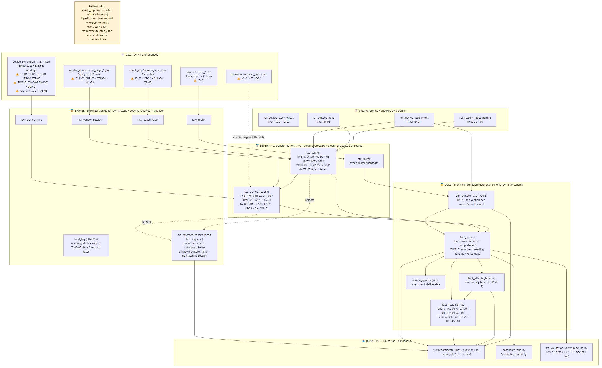
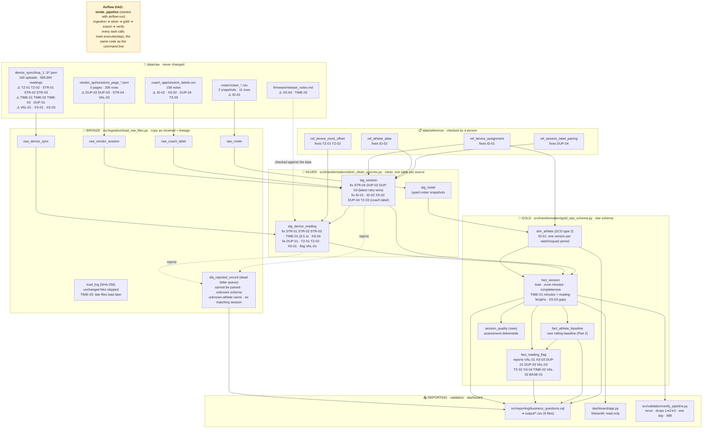
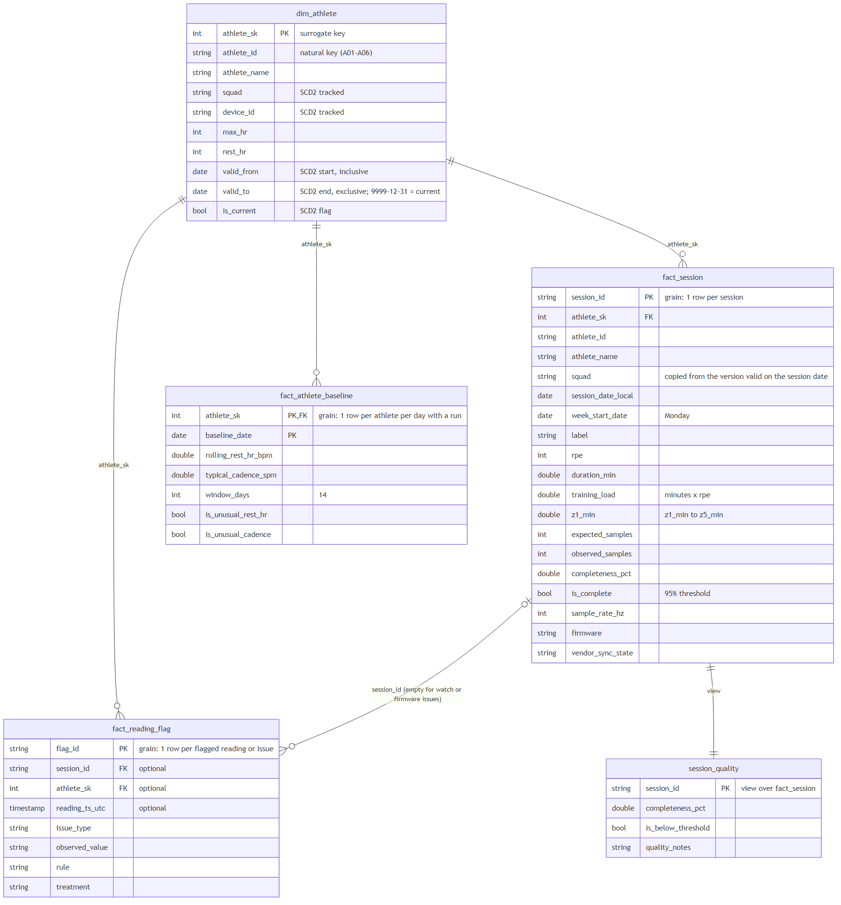
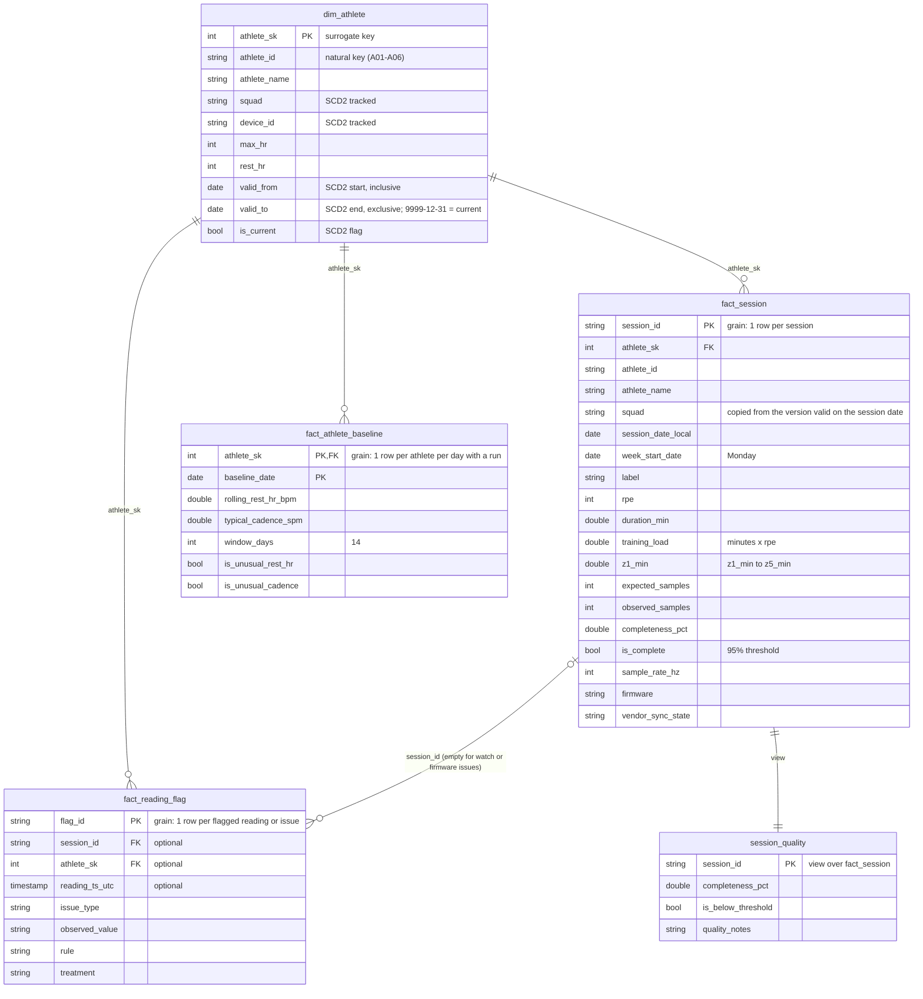

# Architecture

How the raw files become the answer tables, where each data problem lives, and what every table means.
Problem codes such as `TZ-02` are explained in [data_issues.md](data_issues.md).

## 1. The idea in one paragraph

Raw files are copied into a database **unchanged** first (Bronze), then cleaned and connected (Silver), then turned into
answers (Gold, a small star schema). This order is called **ELT**: Extract, Load, then Transform. Everything lives in one
DuckDB file, `data/warehouse/stride.duckdb`, in three **schemas** (folders inside the database): `bronze`, `silver`, `gold`.
Every table is built by one Python function named `build_<table>` that runs one SQL statement, so the SQL is the logic and
Python only decides the order.

| Layer | Code | What it does | Tables |
|---|---|---|---|
| Raw | `data/raw/` | The original files as delivered. Never changed | 5 folders |
| Bronze | [src/ingestion/load_raw_files.py](../src/ingestion/load_raw_files.py) | Copies each file as it is, plus where it came from (`source_file`, `drop_no`, `loaded_at`). A SHA-256 fingerprint of each file in `bronze.load_log` means an unchanged file is never copied twice. Records and files it cannot use go to the dead letter queue | 6 |
| Reference | `data/reference/*.csv` | 4 small lists checked by a person: watch clocks, who wore which watch in which squad and when, name spellings, one note pairing. They hold facts the raw data does not say | 4 files |
| Silver | [src/transformation/silver_clean_sources.py](../src/transformation/silver_clean_sources.py) | Fixes the problems; one clean table per source, plus the reference lists loaded as tables | 7 |
| Gold | [src/transformation/gold_star_schema.py](../src/transformation/gold_star_schema.py) | The star schema: 1 dimension, 3 facts, 1 view | 4 + 1 view |
| Reporting | [reporting/](../src/reporting/) | `business_questions.sql` holds every question; `export_answers.py` writes one CSV per question | 6 CSVs |
| Validation | [validation/](../src/validation/) | `profile_raw_data.py` audits the raw files; `verify_pipeline.py` proves the pipeline is safe to re-run | — |

**Who runs it:** you (type `run`, or `make run`) or Airflow (type `airflow-run`;
[orchestration/airflow/dags/stride_pipeline_dag.py](../orchestration/airflow/dags/stride_pipeline_dag.py)). Both call
`main.execute(step)`, so there is only one copy of the logic.

## 2. Naming convention

| Rule | Example |
|---|---|
| Schema + table prefix says the layer | `bronze.raw_*`, `silver.stg_*` (staging), `silver.ref_*` (reference list), `gold.dim_*`, `gold.fact_*` |
| Everything is `snake_case` | `session_date_local` |
| Units are in the name | `duration_min`, `hr_bpm`, `cadence_spm`, `completeness_pct`, `ts_utc` |
| Yes/no columns start with `is_` (or `was_`) | `is_complete`, `is_hr_glitch`, `was_changed_by_vendor` |
| `*_id` is a natural key (from the source); `*_sk` is a surrogate key (made by us) | `athlete_id` = A01, `athlete_sk` = 1 |
| Every silver and gold table ends with `built_at` | when the row was written (used by the one-day proof) |

## 3. Flow map: where each problem lives

A README deliverable. ⚠️ on a raw file = the problem enters there; "fix" on a Silver table = it is fixed there; a code on
a Gold table = it is reported there. The picture at the top of this page is this diagram.

The same map as a table:

| Problem | Enters at (raw file → field) | Fixed in | Visible in (Gold) |
|---|---|---|---|
| **Timezone 1: watch times have no clock label** (TZ-01) | `device_sync` → `samples[].t` | `silver.stg_device_reading` + `ref_device_clock_offset` | every local time |
| **Timezone 2: Zainab's watch clock set to UTC+3** (TZ-02) | `device_sync` (D014) → `samples[].t` | `ref_device_clock_offset` (180 min) → `silver.stg_device_reading` | `fact_reading_flag` |
| **Timezone 3: coach entry time has no clock label** (TZ-03) | `coach_app` → `entered_at` | not used | — |
| **Timing 1: heart rate twice per second** (TIME-01) | `device_sync` → `samples[].t` (`.500`) | `silver.stg_device_reading.sample_interval_s` | `fact_session` (minutes from reading lengths), the README reconciliation table (921 vs 689) |
| **Timing 2: GPS twice as fast on 2.4.0** (TIME-02) | `device_sync` → `samples[].gps` | not used for distance | `fact_reading_flag` |
| **Timing 3: late data in the next delivery** (TIME-03) | `device_sync/drop_3` → `uploaded_at` | `bronze.load_log` (late files load when they come) | drop-by-drop proof |
| **File layout 1: renamed fields** (STR-01) | `samples[].hr` / `heart_rate`, `lat` / `gps.lat` | `silver.stg_device_reading` | — |
| **File layout 2: cadence as text** (STR-02) | `samples[].cadence` | `silver.stg_device_reading` | — |
| **File layout 3: hdop only in the new app** (STR-03) | `samples[].gps.hdop` | `silver.stg_device_reading` | — |
| **File layout 4: page holds more than page_size** (STR-04) | `vendor_api` → `page_size`, `sessions[]` | `silver.stg_session` (every entry read) | — |
| **Duplicate 1: one run uploaded twice** (DUP-01) | `device_sync/drop_2` (2 files) | `silver.stg_device_reading` (`copies_received`) | `fact_session`, `fact_reading_flag` |
| **Duplicate 2: vendor pages overlap** (DUP-02) | `vendor_api/sessions_page_2/3` | `silver.stg_session` | — |
| **Duplicate 3: retry changed a run** (DUP-03) | `vendor_api/sessions_page_4(_retry)` | `silver.stg_session` (latest retry wins, `previous_duration_s` kept) | `fact_session`, `fact_reading_flag` |
| **Duplicate 4: two runs and two notes on one day** (DUP-04) | `coach_app` → `athlete_name`, `session_date` | `ref_session_label_pairing` → `silver.stg_session.label_match_method` | `fact_session.label_match_method` |
| **Odd value 1: 247 bpm** (VAL-01) | `device_sync/drop_1/B5c55d32a-6.json` | `silver.stg_device_reading.is_hr_glitch` | `fact_reading_flag`, `fact_session` |
| **Odd value 2: GPS vs vendor distance** (VAL-02) | `distance_m` vs `samples[].lat/lon` | vendor distance used | `fact_reading_flag` |
| **Odd value 3: vendor always says "complete"** (VAL-03) | `vendor_api` → `sync_state` | ignored; completeness measured | `fact_session.is_complete`, `fact_reading_flag` |
| **Who-is-who 1: roster changes have no dates** (ID-01) | `roster/*.csv` → `squad`, `device_id` | `ref_device_assignment` → `silver.stg_session.athlete_id`, `gold.dim_athlete` (SCD2) | `dim_athlete`, `fact_session.squad`, Q4 roster |
| **Who-is-who 2: 29 name spellings** (ID-02) | `coach_app` → `athlete_name` | `ref_athlete_alias` → `silver.stg_session` | — |
| **Mismatch 1: readings have no session_id** (XS-01) | `samples[]` | `silver.stg_device_reading.session_id` (as-of join on watch + time) | — |
| **Mismatch 2: notes have no session_id** (XS-02) | `coach_app` | `silver.stg_session` (athlete + date) | `fact_session.label`, `rpe` |
| **Mismatch 3: readings missing inside a run** (XS-03) | `device_sync/drop_2` (S0b21423f), retry (Se06bc0e7) | never filled in; measured in `fact_session` | `fact_session.longest_gap_s`, `fact_reading_flag` |
| **Mismatch 4: release notes wrong about app 5.2.0** (XS-04) | `firmware/release_notes.md` vs `firmware`, `app_version` | `silver.stg_device_reading` (decided from timestamps) | `fact_reading_flag` |
| **Mismatch 5: README says per-second samples** (XS-05) | `README.md` | handled as TIME-01 | — |

## 4. How the tables connect (ERD)

An **ERD** (entity-relationship diagram) shows tables and how they link. **PK** = primary key (the column(s) that name one
row), **FK** = foreign key (a column pointing at another table's key), **SCD2** = a column used by the "slowly changing
dimension, type 2" history.

### Gold: a star schema (`dim_athlete` in the middle, three facts around it)

## 5. Every table

**Type** = what the table is for. **SCD** = slowly changing dimension type (only `dim_athlete` keeps history). **Grain** = what
one row means. Keys are tested for "unique and never empty" by `tests/test_pipeline.py`.

| Table | Type | SCD | Rows | Grain (one row =) | Key |
|---|---|---|---|---|---|
| `bronze.raw_device_sync` | raw copy | — | 585,660 | one watch reading as received (copies included), batch header repeated | `source_file, sample_no` |
| `bronze.raw_vendor_session` | raw copy | — | 206 | one entry on a vendor page | `source_file, record_no` |
| `bronze.raw_roster` | raw copy | — | 11 | one roster CSV row | `source_file, row_no` |
| `bronze.raw_coach_label` | raw copy | — | 158 | one coach-note CSV row | `source_file, row_no` |
| `bronze.load_log` | log | — | 168 | one raw file and its SHA-256 | `source_file` |
| `bronze.dlq_rejected_record` | dead letter queue | — | 0 | one rejected file or record: when, which step, which file, why, and the original payload | none (rows are replaced per step) |
| `silver.ref_athlete_alias` | reference | — | 29 | one accepted spelling of an athlete's name | `raw_name` |
| `silver.ref_device_clock_offset` | reference | — | 6 | one watch and its clock offset | `device_id` |
| `silver.ref_device_assignment` | reference | — | 8 | one period: athlete + watch + squad | `athlete_id, valid_from` |
| `silver.ref_session_label_pairing` | reference | — | 2 | one coach note paired to one run | `label_id` |
| `silver.stg_roster` | staging | — | 11 | one athlete in one roster file | `snapshot_date, athlete_id` |
| `silver.stg_session` | staging | — | 158 | one vendor session (latest version), with athlete and coach label | `session_id` |
| `silver.stg_device_reading` | staging | — | 583,320 | one real watch reading (2,340 copies removed), UTC and local time, run, glitch flag | `reading_id` = watch + watch time |
| `gold.dim_athlete` | dimension | **2** | 8 | one version of an athlete: a new row when the watch or squad changes | `athlete_sk` (natural key `athlete_id` + `valid_from`) |
| `gold.fact_session` | fact | — | 158 | one session | `session_id` |
| `gold.fact_athlete_baseline` | fact | — | 157 | one athlete on one day with a run, against the previous 14 days | `athlete_sk, baseline_date` |
| `gold.fact_reading_flag` | fact | — | 12 | one flagged reading, run, watch or firmware group | `flag_id` |
| `gold.session_quality` | view over `fact_session` | — | 158 | one session (the assessment's required table) | `session_id` |

Every Silver and Gold table also has `built_at` (when the row was written). Rebuilding one day changes `built_at` only
on that day's rows, which is how the one-day proof shows the other days were not touched.

### Why the star schema looks like this

- **`fact_session` is one wide table on purpose.** Weekly load, zone minutes and session quality need no join at all.
- **`squad` is copied onto `fact_session`** from the `dim_athlete` version that was valid on the session date. This is
  intentional denormalization: it saves a join in every report, and it keeps the squad *as it was that day* (Bilal's run on
  10 Aug stays Endurance after Bilal moves to Speed).
- **`dim_athlete` is SCD type 2:** instead of overwriting an athlete's squad or watch, a new row is added with its own
  `valid_from` (inclusive) and `valid_to` (exclusive, `9999-12-31` while current). A fact is joined to the version where
  `valid_from <= session date < valid_to`.
- **Join rules.** Weekly load, zone minutes and session quality use `fact_session` only. The 14 Aug roster uses `dim_athlete`
  only. Every other report needs at most one join (fact → `dim_athlete`).

## 6. Gold columns

| Column | Meaning |
|---|---|
| `duration_min` | the vendor's run length (latest download), seconds ÷ 60 |
| `training_load` | session-RPE load: `duration_min × rpe` |
| `z1_min` … `z5_min` | minutes in each heart-rate zone: sum of reading lengths (0.5 s or 1 s) in that zone. Z1 below 60% of `max_hr`, Z2 60–70%, Z3 70–80%, Z4 80–90%, Z5 90% and above; a boundary goes to the higher zone |
| `expected_samples` | seconds in the run (one sample per second) |
| `observed_samples` | seconds of the run with at least one reading (a 2 Hz watch's two readings count as one second) |
| `completeness_pct`, `is_complete` | `observed ÷ expected`, one decimal; complete = at least 95% |
| `longest_gap_s` | the longest stretch without readings inside the run |
| `sample_rate_hz` | 1, or 2 on firmware 2.4.0 |
| `duplicate_readings_removed`, `hr_glitches_removed` | copies dropped (DUP-01); impossible heart rates left out (VAL-01) |
| `was_changed_by_vendor`, `previous_duration_min` | the retry download changed the run (DUP-03), and the old value |
| `label`, `rpe`, `label_match_method` | the coach's note, effort 1–10, and how it was matched (exact, or inferred for Sara on 12 Aug) |
| `day_rest_hr_bpm`, `rolling_rest_hr_bpm` | lowest 1-minute average heart rate of the day's runs; median of the previous 14 days |
| `day_cadence_spm`, `typical_cadence_spm` | median steps per minute of the day; median of the previous 14 days |
| `is_unusual_rest_hr`, `is_unusual_cadence` | more than 5 bpm / 8 steps per minute away from the baseline (needs 3 earlier days) |
| `issue_type`, `observed_value`, `rule`, `treatment` | the problem found, what we saw, what it should be, and what we did |

## 7. The dead letter queue (DLQ)

A record the pipeline cannot use does not stop the run and is not silently thrown away: it is written to
`bronze.dlq_rejected_record` with **when** (`rejected_at`), **which step** (`pipeline_step`), **which file**, **why**
(`reason`) and the **original record** (`raw_payload`). The run keeps going with everything else.

| Rejected when | `pipeline_step` | Example reason |
|---|---|---|
| A file cannot be parsed | `ingestion` | `cannot be parsed: ...` |
| A file has an unknown layout (missing list or columns) | `ingestion` | `unknown schema: expected batch_id, device_id and a samples list` |
| A reading, vendor row or coach note cannot be parsed | `silver` | `unparseable timestamp t`, `unparseable rpe` |
| A reading has no heart-rate field in either app layout | `silver` | `unknown schema: no heart rate field (hr or heart_rate)` |
| A coach note names an athlete that is not in the spelling list | `silver` | `unknown athlete name: Nobody Here` |
| A coach note or a reading matches no session | `silver` | `no matching session: no run by this athlete on that date` |

Every run prints the count on its last line (`Rejected records (DLQ): 0`) and `export` writes
`output/dlq_rejected_records.csv`. Re-running never duplicates a row, and a record keeps its first `rejected_at`. A file that
is fixed leaves the queue on the next run. Readings that match no session are listed in the DLQ and also stay in
`silver.stg_device_reading` with an empty `session_id`. The real data has 0 rejected records.

## 8. Re-running, late data and one-day reprocessing

- **Re-run:** `bronze.load_log` stores each file's SHA-256. An unchanged file is skipped; a changed one is replaced in a
  single transaction (all or nothing). Silver and Gold are rebuilt with `CREATE OR REPLACE`, so a second run gives identical
  tables.
- **Drops one at a time:** each drop only adds files; Silver and Gold are rebuilt from everything received so far. After drop 3
  the tables are identical to loading all at once.
- **One day:** `reprocess --day 2026-08-14` re-copies that day's watch files, then rebuilds that day's rows in
  `silver.stg_session`, `silver.stg_device_reading` and `gold.fact_session` (`DELETE` + `INSERT`). The small whole-season
  tables (baseline, flags) are recalculated, because a rolling baseline spans many days. `verify` proves every other day is
  untouched.
